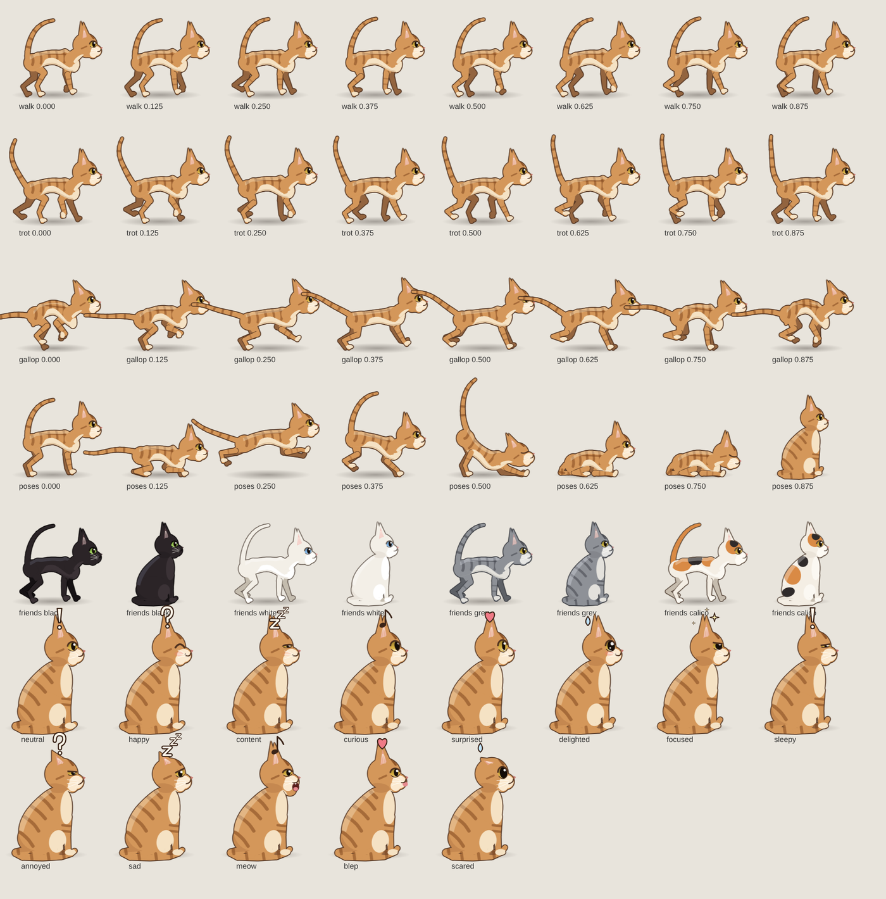

# 小貓環島記 · A Cat's Journey Around Taiwan

一部 3 分 51 秒的電影感動畫短片：一隻虎斑貓從臺北出發，順時針走遍全台 **22 個縣市**，沿途經過 22 段真實的路線風景，最後回到臺北睡著。

整部片沒有任何點陣素材或影片素材：**每一格畫面都由 Canvas 2D 程式即時繪製**，再用 WebGL 做最後的光影調色（泛光、光線散射、水面波紋；沒有 WebGL 時自動退回 Canvas 版本），配樂也是用 Python 合成的原創鋼琴與弦樂。同一份程式碼可以在瀏覽器裡即時播放，也可以用無頭瀏覽器逐格算圖、輸出成 MP4。



## 內容

| | |
|---|---|
| 片長 | 231.2 秒（24 fps，1920×1080，2.39:1 寬銀幕構圖） |
| 場景 | 23 個主景點（22 縣市，臺北出現兩次）＋ 22 段沿途轉場 |
| 貓咪 | 走、小跑、奔跑、伏低、撲跳、跳上物件、炸毛、落地、伸懶腰、打哈欠、舔毛、洗臉、揮爪、打噴嚏、趴、睡；12 種表情與「！ ？ Z ♪ ♥」漫畫符號 |
| 互動 | 每個景點是一段配合字幕的小故事：海鷗、螃蟹、蝴蝶、鯉魚、蜻蜓、桐花、柿子、燈籠倒影、汽笛、車燈… |
| 朋友 | 沿途交到黑貓、白貓、灰貓、三花、賓士貓等朋友，一起看夕陽、看飛機、追藍眼淚，最後都出現在夢裡 |
| 字幕 | 每段一句中英雙語旁白，加上地點章節卡 |
| 配樂 | 起、承、轉、合、尾聲五段的原創配樂，時間點對齊畫面 |

完整分鏡（時間、地點、貓咪動作、字幕、配樂段落）見 [docs/STORYBOARD.md](docs/STORYBOARD.md)。

## 快速開始

需要 Node.js 18+、Python 3.10+、ffmpeg。

```bash
npm install              # 安裝 playwright
npx playwright install chromium
pip install -r requirements.txt

npm run serve            # 用瀏覽器開 http://localhost:8080 看播放頁
```

播放頁 `index.html` 會播放 `media/film-720p.mp4`；影片載入失敗時，會改用 `src/` 裡的程式即時畫出整部片（沒有配樂）。

### 算出完整影片

```bash
npm run music            # 產生 build/music.wav（約 1 分鐘）
npm run render           # 逐格算圖並合成 build/film.mp4（約 30–40 分鐘）
```

### 只檢查畫面

```bash
npm run shots            # 每個場景各輸出一張 build/shots/t*.jpg
node tools/shots.cjs 12.5 40 88   # 指定秒數
```

`node tools/posesheet.cjs` 會輸出貓咪步態、姿勢與表情的對照圖（`build/posesheet.png`）；`tools/rig3.html` 也可以直接用瀏覽器打開看姿勢表。

## 專案結構

```
index.html          播放頁（GitHub Pages 可直接使用）
render.html         算圖用頁面，被 tools/*.cjs 載入
src/
  core.js           工具函式、圖層快取、運鏡、繪圖基本元件（山、雲、水面、光線）
  gl.js             WebGL 後製（泛光、光線散射、調色、紙紋、顆粒）與水面倒影波紋
  cat3.js           貓咪骨架：無縫輪廓、平塗明暗、外緣描線、步態、表情與漫畫符號
  cat2.js           v2 貓咪骨架（保留給相容層，v3 取用部分函式）
  actions3.js       每個主景點的貓咪故事編排與互動道具（海鷗、螃蟹、蝴蝶…）
  scenesA.js        主景點 L0–L11
  scenesB.js        主景點 L12–L22
  transitions.js    22 段沿途轉場 T0–T21
  main.js           時間軸、轉場淡入淡出、後製（bloom、調色、顆粒、寬銀幕）、字幕、片尾
tools/
  render.cjs        逐格算圖並交給 ffmpeg 合成
  shots.cjs         截取指定秒數的畫面
  music3.py         配樂合成
  posesheet.cjs     貓咪步態／姿勢／表情對照圖
  rig3.html         貓咪姿勢表
media/              網頁用 720p 影片與海報（1080p 下載檔在 GitHub Releases）
docs/               分鏡、參考資料、製作流程、版本紀錄
legacy/v1/          第一版（一分鐘柔和手繪風）
```

## 文件

- [CLAUDE.md](CLAUDE.md)：給 Claude Code 等 AI 協作工具看的專案說明（架構、慣例、怎麼加新場景）
- [docs/STORYBOARD.md](docs/STORYBOARD.md)：分鏡表
- [docs/PIPELINE.md](docs/PIPELINE.md)：算圖、壓縮、母片分割與合併的流程
- [docs/REFERENCES.md](docs/REFERENCES.md)：參考資料來源
- [docs/CHANGELOG.md](docs/CHANGELOG.md)：v1 → v4 的改動

## 授權

尚未指定授權。上傳前請自行加入 `LICENSE`。若要開放給他人使用，程式碼常見選擇是 MIT，影片與配樂則常用 CC BY 4.0。
